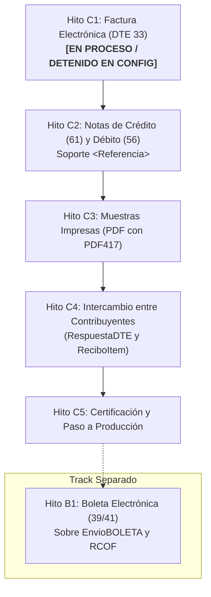

# Certificación DTE ante el SII (Chile) — Plan de Hitos y Roadmap

## 1. Contexto Normativo y Realidad del Proceso

El Servicio de Impuestos Internos (SII) estructura la certificación de Facturación Electrónica en etapas secuenciales y obligatorias.

> [!IMPORTANT]
> **Diferencia Crítica: Facturación Electrónica vs. Boleta Electrónica**
>
> Las **Boletas Electrónicas (DTE 39 y 41)** NO forman parte de la certificación de Facturación Electrónica ni deben implementarse antes de las Notas de Crédito/Débito por las siguientes razones normativas y técnicas:
>
> 1. **Procesos de Certificación Separados:** La postulación y set de pruebas de Boleta Electrónica es un trámite completamente independiente en el portal del SII.
> 2. **Esquema XML Distinto:** La boleta no utiliza el contenedor `<EnvioDTE>`, sino `<EnvioBOLETA>` con el esquema `EnvioBOLETA_v11.xsd` y reglas de carátula propias.
> 3. **Endpoints y Reportes Propios:** Exige transmisión vía Web Service dedicado de boletas y el envío diario obligatorio del **RCOF** (Resumen de Consumo de Folios).
> 4. **Prerrequisito Obligatorio del Set Básico de Facturación:** Para aprobar la certificación de Factura Electrónica (DTE 33), el SII exige **obligatoriamente** emitir Notas de Crédito (DTE 61) y Notas de Débito (DTE 56) que anulen o corrijan las facturas del set. Postergar las Notas de Crédito/Débito bloquea de raíz la certificación de facturación.

---

## 2. Estado Actual y Plan de Hitos

---

## 3. Detalle de Hitos

### Hito C1: Emisión y Envío de Facturas Electrónicas (DTE 33)

- **Estado:** En proceso (código core implementado, detenido en configuración de emisor).
- **Problema Detectado:** Rechazo de carátula `EnvioDTE` al enviar con resolución real en ambiente de certificación.
- **Solución Aplicada:** Documentación explícita en OpenAPI/Swagger para configurar `nroResol = 0` y `fchResol = "2014-08-22"` en ambiente de certificación (`PUT /tenants/issuer`).
- **Criterio de Éxito:** Envío exitoso del set de facturas de prueba al SII con `trackId` retornado y estado `EPR` (Envío Procesado) sin rechazos de carátula.

---

### Hito C2: Notas de Crédito (DTE 61) y Débito (DTE 56) con Referencias

- **Estado:** Pendiente (requisito inmediato para completar el Set Básico del SII).
- **Alcance:**
  1. Extender `IssueInvoiceDto` con el arreglo `referencias` (`nroLinRef`, `tpoDocRef`, `folioRef`, `fchRef`, `codRef`, `razonRef`).
  2. Extender entidad de dominio `Invoice` y `InvoiceProps` para almacenar referencias fiscales.
  3. Actualizar `DteXmlRenderer` para inyectar los nodos `<Referencia>` entre `<Detalle>` (o `<DscRcgGlobal>`) y `<TED>` según el estándar XSD del SII.
  4. Habilitar tipos de DTE 61 y 56 en la asignación de folios, CAF y firmas.
- **Criterio de Éxito:** Capacidad de emitir un DTE 61 que referencie una factura previamente emitida y sea validado contra `DTE_v10.xsd` y que los nuevos cambios no afecten la implementación previa de Facturación Electrónica.

---

### Hito C3: Generación de Muestras Impresas (PDF con Timbre PDF417)

- **Estado:** Aplazado según requerimiento del usuario.
- **Alcance:**
  1. Definir estrategia técnica para renderizar el documento tributario en PDF sin violar restricciones de dependencias del repositorio.
  2. Generación del código de barras bidimensional PDF417 codificando exactamente el fragmento `<TED>...</TED>`.
  3. Endpoint `GET /invoices/:folio/pdf`.
- **Criterio de Éxito:** Generación de PDF legible que pase la validación visual y de lector óptico exigida por el SII para las muestras impresas.

---

### Hito C4: Intercambio entre Contribuyentes y Acuse de Recibo

- **Estado:** Aplazado según requerimiento del usuario.
- **Alcance:**
  1. Envío automático o manual del XML firmado al correo de intercambio del receptor.
  2. Endpoint para recepción de XMLs de proveedores.
  3. Generación y firma de `RespuestaDTE` (aceptación/rechazo técnico) y `ReciboItem` (acuse de recibo comercial).
- **Criterio de Éxito:** Aprobación de la prueba de intercambio de correos con el SII.

---

### Hito C5 (Track Separado): Boletas Electrónicas (DTE 39 / 41)

- **Estado:** Fuera del alcance de la certificación de facturación actual.
- **Requisitos Técnicos:**
  1. Implementación de builder de sobre `<EnvioBOLETA>` y validación con `EnvioBOLETA_v11.xsd`.
  2. Módulo de generación de Resumen Diario de Boletas (`ConsumoFolios` / RCOF).
  3. Integración con endpoints específicos del SII para boletas (`POST /boleta.electronica.envio`).
